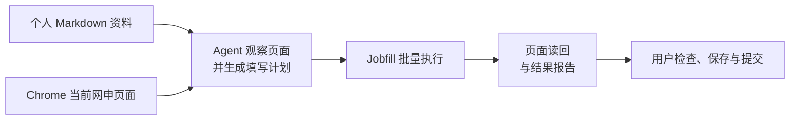

<div align="center">

# Jobfill

### 一份资料，多次复用；填写之后，核对结果。

让 Agent 根据你的资料核对网申页面，填写有依据的字段，<br>
并把未完成和需要确认的地方清楚交还给你。

[](https://nodejs.org/)
[](https://developers.openai.com/codex/skills/)
[](https://github.com/alchaincyf/huashu-chrome)

[快速开始](#快速开始) · [工作方式](#工作方式) · [验证与边界](#验证与边界)

</div>

```bash
git clone https://github.com/K0848/jobfill.git
```

> **使用前提：** Node.js、Codex 和已连接自己 Chrome 的 [Huashu Chrome](https://github.com/alchaincyf/huashu-chrome)。网申页面的最终检查、保存和提交由你完成。

## 为什么做 Jobfill

投递不同公司的岗位时，同一份教育、实习和项目经历往往要反复填写。网页自动解析也可能漏字段、填错位置，或者把不同经历混在一起。

Jobfill 基于你准备的一份 Markdown 资料，由 Agent 结合**当前页面**生成填写计划。批量工具检查资料来源、目标字段和页面读回结果；不确定的部分留给你处理。

| 网申中常见的问题 | Jobfill 如何处理 |
| --- | --- |
| 同一份经历反复输入 | 复用用户提供的 Markdown 资料，缺少依据的字段留空。 |
| 多条学校、公司或项目容易填串 | Agent 按经历身份核对；计划提供记录身份时，工具会校验是否与资料对应。 |
| 页面已有内容不确定是否正确 | 比较页面现值与资料；有冲突时保留现值，列入待确认。 |
| 点了填写却不知道是否生效 | 读取页面结果，分别报告已匹配、待确认、未支持和未验证等状态。 |

## 工作方式



- **资料来源：** 使用你指定的文件，支持基本信息、教育、工作、项目等记录。经历通过 `identity` 区分；缺少依据的字段应保持空白。
- **页面操作：** 通过 Huashu Chrome 使用你自己的浏览器；普通字段和部分已适配控件可交给批量工具，复杂或不确定的控件需要进一步检查。
- **结果核对：** `attempted` 表示本次写入后读回匹配；`skipped_existing` 表示已有值与目标匹配。`pending`、`unsupported`、`blocked` 和 `write_unverified` 需要继续检查。
- **人工接管：** 资料冲突、选项歧义或无法可靠读回时，保留问题供用户确认。网页可能自动保存或联动，实际状态以页面为准。

## 快速开始

### 1. 准备环境

安装 Node.js 22.19 或更新版本，并按 [Huashu Chrome 的安装说明](https://github.com/alchaincyf/huashu-chrome)配置浏览器连接。安装过程可能修改本机 Agent 的 MCP 配置，请先阅读该项目说明。

```powershell
npx huashu-chrome doctor
```

确认桥接和浏览器扩展在线后，克隆本仓库并进入目录：

```powershell
git clone https://github.com/K0848/jobfill.git
cd jobfill
```

### 2. 准备自己的资料

在项目目录中创建 `data/` 文件夹，将 [虚构资料示例](examples/profile.example.md)复制为 `data/profile.md`，用本人**已经确认**的信息替换示例；未知字段留空。请勿覆盖已有资料。

资料中需包含一个 `jobfill: 1` JSON 块。每条教育、工作或项目记录使用组内唯一的 `identity`；详细格式可直接参考示例。

如需单独检查资料解析：

```powershell
node tools/profile-converter.js data/profile.md data/profile.profile.json
```

生成的 JSON 包含个人信息，请留在受保护的本机位置。

### 3. 在 Codex 中开始

在 Codex 中以本仓库为项目根目录，打开你的招聘表单，并在会话中说明资料路径。例如：

> 使用 $fill-job-application，根据 data/profile.md 核对并填写我当前打开的招聘页面；先保留有冲突的已有内容，填写后列出需要我检查的项目。

项目级 Skill 位于 [`.agents/skills/fill-job-application/SKILL.md`](.agents/skills/fill-job-application/SKILL.md)。如果 Skill 未出现，可重新打开项目并检查是否存在同名 Skill。

## 一次填写的结果是什么样的？

以下是一次**本地测试页面**的精简结果：使用虚构资料，通过真实 Chrome 和 Huashu Chrome 写入一个普通文本框，再读取页面中的值。

```json
{
  "profileValidated": true,
  "snapshotCaptured": true,
  "items": [
    {
      "pageLabel": "姓名",
      "value": "示例姓名",
      "status": "attempted",
      "readback": "matched"
    }
  ]
}
```

这说明该测试字段写入后读回匹配。实际网申的页面结构、控件和保存方式可能不同，**不能把一个字段的成功当作整份申请已完成**。

Agent 根据页面观察生成批量请求；请求结构可参考 [request.example.json](examples/request.example.json)。示例中的网址、标签和选择器均为虚构内容，不能直接用于真实申请。准备好自己的请求后，可在仓库根目录运行：

```powershell
node tools/jobfill-batch-cli.js --request-file data/request.json
```

## 隐私与操作边界

- 仓库只提供工具和虚构示例。请勿提交真实资料、请求、报告、浏览器配置、凭据或网申截图。
- `.gitignore` 默认忽略未列入公开白名单的本地文件；新增公开文件需审查后放行。已被 Git 跟踪的文件仍需在提交前检查内容。
- Agent 和浏览器工具会读取所需资料，数据处理取决于所用服务与配置。
- Skill 默认不代替用户点击网站的保存、下一步或提交，也不默认修改个人资料或投递跟进表。验证码、协议及最终提交由用户处理。
- 本项目以 Codex Skill 和 Node.js 脚本协同工作；`extension/` 是脚本使用的模块集合，不是可独立安装的 Chrome 扩展。

## 验证与边界

本仓库包含 **9 个回归脚本**，覆盖资料解析、语义匹配、站点规则、标签定位、桥接、控件执行和批量运行。以下命令使用虚构资料或模拟桥接：

```powershell
node --test tests/profile-converter.cjs tests/semantic-mapper.cjs tests/site-hints.cjs tests/tab-resolver.cjs tests/huashu-bridge.cjs tests/widget-executor.cjs tests/jobfill-independent-checker.cjs tests/jobfill-runtime.cjs tests/jobfill-cli-process.cjs
```

另有上文所述的真实浏览器本地表单验证。招聘网站、日期、多选、附件和复杂弹层的兼容性取决于当前页面，未适配或无法可靠读回时应由用户检查。

## 致谢与授权

浏览器交互依赖 [Huashu Chrome](https://github.com/alchaincyf/huashu-chrome)；控件识别与操作思路曾参考 [auto-ws](https://github.com/happy-q123/auto-ws)。

本仓库尚未指定开源许可证；需要再分发或二次使用时，请先联系项目所有者确认授权。
